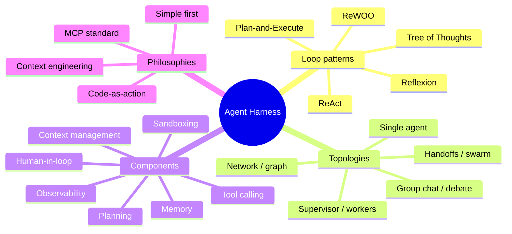
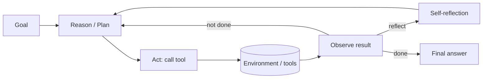
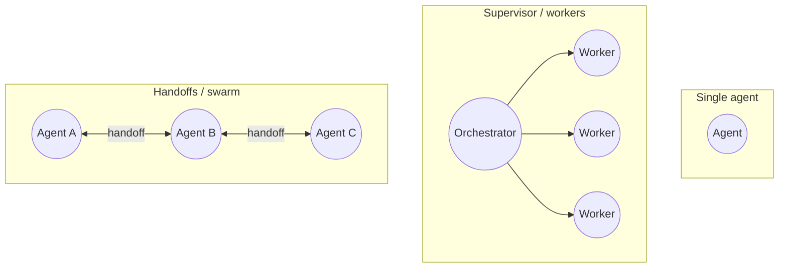

# Awesome Agent Harnesses 

**The definitive, curated map of agent harnesses** — the runtime scaffolding that turns an LLM into an agent. Concepts, design patterns, architectures, frameworks, coding agents, papers, and benchmarks.

*A raw LLM predicts tokens. A harness gives it a loop, tools, memory, control flow, and a sandbox — and turns it into something that acts. This is everything worth understanding, building on, and benchmarking.*

---

> **What's a harness?** The model is the engine; the **harness** is the car built around it — the runtime scaffolding that processes inputs, orchestrates tool calls, manages the context window, enforces safety, handles errors, and returns results in a loop. Anthropic describes the Claude Agent SDK as exactly this: *"a general-purpose agent harness adept at coding... that requires the model to use tools to gather context, plan, and execute."* This list maps the concepts behind harnesses **and** the open-source harnesses themselves.

## Contents

- [TL;DR — Start Here](#tldr--start-here)
- [Concepts & Architecture](#concepts--architecture)
  - [Harness vs framework vs scaffolding vs agent vs workflow](#harness-vs-framework-vs-scaffolding-vs-agent-vs-workflow)
  - [The agent loop & reasoning patterns](#the-agent-loop--reasoning-patterns)
  - [Orchestration topologies](#orchestration-topologies)
  - [Core harness components](#core-harness-components)
  - [Design philosophies](#design-philosophies)
- [General Agent Frameworks](#general-agent-frameworks)
- [Coding-Agent Harnesses](#coding-agent-harnesses)
- [Feature Comparison](#feature-comparison)
- [Standards & Protocols](#standards--protocols)
- [Sandboxing & Execution Infra](#sandboxing--execution-infra)
- [Research Papers](#research-papers)
  - [Surveys & frameworks](#surveys--frameworks)
  - [Reasoning & the loop](#reasoning--the-loop)
  - [Tool use](#tool-use)
  - [Coding & computer agents](#coding--computer-agents)
  - [Multi-agent](#multi-agent)
- [Benchmarks & Leaderboards](#benchmarks--leaderboards)
  - [Coding-agent benchmarks](#coding-agent-benchmarks)
  - [General agent & tool-use benchmarks](#general-agent--tool-use-benchmarks)
  - [Web / computer-use benchmarks](#web--computer-use-benchmarks)
  - [Leaderboards](#leaderboards)
- [Articles & Deep Dives](#articles--deep-dives)
- [Talks & Courses](#talks--courses)
- [Other Awesome Lists](#other-awesome-lists)
- [Contributing](#contributing)

---

## TL;DR — Start Here

The shortest path to understanding how agents are actually built:

1. **Read** [Anthropic — Building Effective Agents](https://www.anthropic.com/engineering/building-effective-agents) (the workflows-vs-agents distinction + 5 core patterns) and [Lilian Weng — LLM Powered Autonomous Agents](https://lilianweng.github.io/posts/2023-06-23-agent/).
2. **Understand the loop**: [ReAct](https://arxiv.org/abs/2210.03629) (reason+act) is the canonical single-agent loop; [Reflexion](https://arxiv.org/abs/2303.11366) adds self-correction; [CodeAct](https://arxiv.org/abs/2402.01030) makes the action space *executable code*.
3. **Pick a framework**: [LangGraph](https://github.com/langchain-ai/langgraph) (graph/state) or [OpenAI Agents SDK](https://github.com/openai/openai-agents-python) (minimal) or [smolagents](https://github.com/huggingface/smolagents) (code-as-action). For coding: [OpenHands](https://github.com/All-Hands-AI/OpenHands) or [Aider](https://github.com/Aider-AI/aider).
4. **Learn the standard**: [MCP (Model Context Protocol)](https://modelcontextprotocol.io/) — how agents connect to tools/data.
5. **Benchmark it**: [SWE-bench Verified](https://www.swebench.com/) (coding), [GAIA](https://huggingface.co/spaces/gaia-benchmark/leaderboard) (general assistant), [τ-bench](https://github.com/sierra-research/tau-bench) (tool+user), [Terminal-Bench](https://www.tbench.ai/) (terminal).

> 💡 **The most important design lesson** ([Anthropic](https://www.anthropic.com/engineering/building-effective-agents)): start with the *simplest* thing that works. Use predictable **workflows** for well-defined tasks; reserve autonomous **agents** for when you genuinely need model-driven flexibility. Frameworks add abstraction that can obscure your prompts — consider going without one first.

---

## Concepts & Architecture

### Harness vs framework vs scaffolding vs agent vs workflow

The terminology is genuinely contested. The distinctions practitioners actually draw:

| Term | What it is | Source |
|---|---|---|
| **Agent** | A system where the LLM *dynamically directs its own process and tool usage* — the model decides the next step in a loop | [Anthropic](https://www.anthropic.com/engineering/building-effective-agents) |
| **Workflow** | LLMs + tools orchestrated through *predefined code paths* — control flow fixed by the developer, not the model | [Anthropic](https://www.anthropic.com/engineering/building-effective-agents) |
| **Harness** | The *runtime* scaffolding wrapping the LLM: orchestrates tool calls, manages context, enforces safety, returns results | [Anthropic](https://www.anthropic.com/engineering/effective-harnesses-for-long-running-agents) |
| **Scaffolding** | The *static setup* phase that assembles the harness (system prompt, tool schemas, subagent registry) before the first prompt; in the SWE-bench community, all non-model code wrapping the LLM | [community](https://github.com/ai-boost/awesome-harness-engineering) |
| **Framework** | A reusable library for *building* harnesses (LangGraph, AutoGen). The toolkit, not the assembled runtime | [Anthropic](https://www.anthropic.com/engineering/building-effective-agents) |

**One-liner:** *Agent* = the autonomous decision-maker · *Harness* = the runtime wrapping it · *Scaffolding* = the static setup that assembles the harness · *Framework* = the library you build harnesses with · *Workflow* = orchestration where code, not the model, holds control.

### The agent loop & reasoning patterns

The core control loop is **perceive → reason → act → observe**, repeated until a stop condition. Patterns differ in how reasoning, acting, and observation interleave.

- **[ReAct](https://arxiv.org/abs/2210.03629)** (Reason + Act) — interleaves reasoning traces with actions; reasoning helps track plans and handle exceptions. The canonical single-agent loop.
- **[Plan-and-Solve](https://arxiv.org/abs/2305.04091)** — split into a planning stage (decompose into sub-tasks) then an execution stage. Cuts missing-step errors.
- **[ReWOO](https://arxiv.org/abs/2305.18323)** — Planner/Worker/Solver; plans the full chain *up front* so it isn't re-prompted on each observation (~5× fewer tokens than ReAct).
- **[Reflexion](https://arxiv.org/abs/2303.11366)** — verbal self-reflection stored in episodic memory; "linguistic" reinforcement without weight updates.
- **[Tree of Thoughts](https://arxiv.org/abs/2305.10601)** — explore a tree of reasoning paths with self-evaluation, lookahead, backtracking (Game-of-24: 4% → 74%).
- **[Evaluator-Optimizer](https://www.anthropic.com/engineering/building-effective-agents)** — one LLM generates, another evaluates/feeds back in a loop until quality criteria are met.

### Orchestration topologies

- **Single agent** — one LLM in a tool loop until it produces a final answer (the ReAct loop).
- **[Supervisor / orchestrator-workers](https://www.anthropic.com/engineering/multi-agent-research-system)** — a central LLM decomposes the task, delegates to workers, synthesizes results. Subtasks determined by input, not predefined.
- **Hierarchical** — supervisors of supervisors; a multi-level tree.
- **Sequential pipeline (prompt chaining)** — ordered steps, each processing the previous output, with optional gates.
- **[Group chat / debate](https://arxiv.org/abs/2308.08155)** — agents take turns in a shared context; a selector or round-robin picks the speaker (AutoGen).
- **[Handoffs / swarm](https://github.com/openai/swarm)** — agents delegate via a tool call while sharing message context; decentralized routing, no central orchestrator.
- **Blackboard** — agents read/write a shared state store until a solution emerges.
- **[Network / graph](https://langchain-ai.github.io/langgraph/concepts/)** — execution as nodes + (conditional) edges over shared state, with cycles for loops/retries/reflection (LangGraph's model).

### Core harness components

| Component | What it does |
|---|---|
| **Tool / function calling** | Dispatch tool calls, run them, feed results back — the augmented-LLM building block |
| **System prompt / instructions** | Standing role, constraints, tool-use policy — competes for the context budget |
| **[Context management & compaction](https://www.anthropic.com/engineering/effective-context-engineering-for-ai-agents)** | Summarize a near-full window and reinitialize — core for long-horizon agents |
| **Memory integration** | Episodic/long-term stores + structured note-taking so state survives context resets |
| **Planning** | Explicit plan generation/decomposition before execution |
| **Error handling / retries** | Recovery via git history, progress files, re-orientation at session start |
| **[Human-in-the-loop](https://langchain-ai.github.io/langgraph/concepts/)** | Approval gates, interrupts, MCP *elicitation* |
| **Guardrails** | Safety/validation; MCP requires explicit user consent for data access & tool calls |
| **Structured output** | Constrain output to a schema (JSON / typed objects) for reliable parsing |
| **State / checkpointing** | Save state per step; resume after failure (LangGraph checkpointers, Sqlite/Postgres) |
| **Observability / tracing** | Capture every prompt, tool call, decision for debugging & eval |
| **[Sandboxing & code execution](https://www.spheron.network/blog/ai-agent-code-execution-sandbox-e2b-daytona-firecracker/)** | Isolated envs for model-generated code — Docker (shared kernel) vs microVMs (own kernel, ~150ms) |
| **[Agent-Computer Interface (ACI)](https://arxiv.org/abs/2405.15793)** | Purpose-built file/repo/exec commands for LM agents — took SWE-bench 3.8% → 12.5% |
| **[Computer / browser use](https://www.anthropic.com/news/3-5-models-and-computer-use)** | Control a screen via virtual mouse/keyboard when no direct connector exists |

### Design philosophies

- **Simple first** ([Anthropic](https://www.anthropic.com/engineering/building-effective-agents)) — find the simplest solution; add complexity only when demonstrably needed; consider skipping frameworks.
- **Context engineering** ([Anthropic](https://www.anthropic.com/engineering/effective-context-engineering-for-ai-agents)) — selecting & maintaining the optimal token set during inference; the successor to prompt engineering.
- **[Code-as-action (CodeAct)](https://arxiv.org/abs/2402.01030)** — the action space should be *executable code*, not JSON/text; lets the agent compose tools and self-debug (~+20% success).
- **The bitter lesson for agents** — general methods that scale with compute beat hand-engineered heuristics; the smarter the model, the less "how" scaffolding you need. Don't over-engineer brittle control logic the model will soon do itself.
- **Don't build multi-agents (unless you must)** — [Cognition](https://cognition.ai/blog/dont-build-multi-agents) argues for single-threaded context; [LangChain](https://www.langchain.com/blog/how-and-when-to-build-multi-agent-systems) gives the counterpoint. Read both.
- **MCP as a standard** ([Anthropic](https://www.anthropic.com/news/model-context-protocol)) — an open JSON-RPC protocol standardizing how agents connect to tools/data; "the USB-C of AI tooling."

---

## General Agent Frameworks

> ⭐ Stars are rough order-of-magnitude as of June 2026.

| Framework | Stars | Lang | License | Distinctive harness design |
|---|---|---|---|---|
| [LangChain](https://github.com/langchain-ai/langchain) | ~110k | Py/JS | MIT | The original chains + AgentExecutor ReAct tool-loop abstraction |
| [LangGraph](https://github.com/langchain-ai/langgraph) | ~16k | Py/JS | MIT | Stateful graph of nodes/edges; checkpointing, time-travel, HITL interrupts |
| [AutoGen](https://github.com/microsoft/autogen) | ~50k | Python | MIT | Event-driven multi-agent conversation ⚠️ maintenance mode → MS Agent Framework |
| [AG2](https://github.com/ag2ai/ag2) | ~3k | Python | Apache-2.0 | Community AutoGen fork; cross-framework agent interop |
| [CrewAI](https://github.com/crewAIInc/crewAI) | ~40k | Python | MIT | Role/goal/backstory DSL; sequential & hierarchical processes, no LangChain dep |
| [OpenAI Agents SDK](https://github.com/openai/openai-agents-python) | ~19k | Python | MIT | Minimal primitives: agents + handoffs + guardrails + sessions + tracing (Swarm successor) |
| [Google ADK](https://github.com/google/adk-python) | ~17k | Python | Apache-2.0 | Code-first, model-agnostic; hierarchical agents, built-in eval, bidi streaming |
| [Semantic Kernel](https://github.com/microsoft/semantic-kernel) | ~28k | C#/Py/Java | MIT | Enterprise plugin/skill system + planners; merging into MS Agent Framework |
| [smolagents](https://github.com/huggingface/smolagents) | ~15k | Python | Apache-2.0 | `CodeAgent` writes actions as executable Python, not JSON tool calls |
| [Pydantic AI](https://github.com/pydantic/pydantic-ai) | ~14k | Python | MIT | Type-safe, Pydantic-validated outputs + dependency injection; FastAPI-like |
| [DSPy](https://github.com/stanfordnlp/dspy) | ~26k | Python | MIT | *Program* (don't prompt) LLMs; compiler auto-optimizes prompts/weights |
| [LlamaIndex](https://github.com/run-llama/llama_index) | ~47k | Python | MIT | Event-driven Workflows; agents over 160+ data connectors |
| [Haystack](https://github.com/deepset-ai/haystack) | ~23k | Python | Apache-2.0 | Production pipeline DAG + Agent/Tool components for branching loops |
| [Agno](https://github.com/agno-agi/agno) | ~36k | Python | MPL-2.0 | High-perf multi-modal agents; teams, memory, knowledge, reasoning built in (ex-Phidata) |
| [Mastra](https://github.com/mastra-ai/mastra) | ~19k | TS | Apache-2.0 | TS durable graph workflows (suspend/resume), agents, evals (Gatsby team) |
| [Atomic Agents](https://github.com/BrainBlend-AI/atomic-agents) | ~4k | Python | MIT | Input/output schema contracts as composable atomic building blocks |
| [AutoGPT](https://github.com/Significant-Gravitas/AutoGPT) | ~178k | Python | MIT/Polyform | The original autonomous self-prompting plan→act→reflect loop; now a platform |
| [MetaGPT](https://github.com/FoundationAgents/MetaGPT) | ~46k | Python | MIT | Multi-agent "software company" driven by encoded SOPs |
| [CAMEL](https://github.com/camel-ai/camel) | ~13k | Python | Apache-2.0 | Inception-prompting role-play for autonomous agent cooperation at scale |
| [ChatDev](https://github.com/OpenBMB/ChatDev) | ~28k | Python | Apache-2.0 | Virtual software company; waterfall SDLC via "chat chain" |
| [SuperAGI](https://github.com/TransformerOptimus/SuperAGI) | ~16k | Python | MIT | Dev-first autonomous agents + GUI, marketplace, trajectory fine-tuning |
| [BabyAGI](https://github.com/yoheinakajima/babyagi) | ~21k | Python | MIT | ~140-line task-creation/prioritization loop over a vector store |
| [Strands Agents](https://github.com/strands-agents/sdk-python) | ~3k | Python | Apache-2.0 | Model-first loop; Swarm/Graph/Workflow patterns, native MCP/A2A (AWS) |
| [BeeAI Framework](https://github.com/i-am-bee/beeai-framework) | ~3k | Py/TS | Apache-2.0 | Cross-framework runtime + ACP (IBM, Linux Foundation) |
| [Langroid](https://github.com/langroid/langroid) | ~3k | Python | MIT | Message-passing multi-agent, explicit task loop, no LangChain dep (CMU/UW) |
| [Griptape](https://github.com/griptape-ai/griptape) | ~2k | Python | Apache-2.0 | Structures (Agent/Pipeline/Workflow) + off-prompt "task memory" |
| [Spring AI](https://github.com/spring-projects/spring-ai) | ~8k | Java | Apache-2.0 | Spring-idiomatic Advisors/ChatClient, tools, RAG for the JVM |
| [LangChain4j](https://github.com/langchain4j/langchain4j) | ~9k | Java | Apache-2.0 | Declarative AiServices interfaces; tools, memory, RAG for Java |
| [TaskWeaver](https://github.com/microsoft/TaskWeaver) | ~6k | Python | MIT | Code-first agent for data analytics; requests → executable code plans |
| [AgentVerse](https://github.com/OpenBMB/AgentVerse) | ~4k | Python | Apache-2.0 | Cooperative task-solving + emergent-behavior simulation modes |

**Low-code / visual builders:** [Dify](https://github.com/langgenius/dify) (~115k), [n8n](https://github.com/n8n-io/n8n) (~150k, fair-code), [Flowise](https://github.com/FlowiseAI/Flowise) (~40k), [Rivet](https://github.com/Ironclad/rivet) (~4k), [Inngest AgentKit](https://github.com/inngest/agent-kit), [Motia](https://github.com/MotiaDev/motia), [VoltAgent](https://github.com/VoltAgent/voltagent).

> ⚠️ **Renames & status to know:** AutoGen → maintenance mode, merging into Microsoft Agent Framework with Semantic Kernel. OpenAI Swarm → deprecated in favor of the Agents SDK. Phidata → renamed **Agno**. MetaGPT → moved to the `FoundationAgents` org. Several "open-source" projects (Dify, n8n, Crush) use non-OSI fair-code licenses — verify before assuming.

---

## Coding-Agent Harnesses

The scaffolding around code-writing agents — terminal CLIs, IDE agents, autonomous engineers.

| Harness | Stars | Lang | License | Distinctive design |
|---|---|---|---|---|
| [Gemini CLI](https://github.com/google-gemini/gemini-cli) | ~70k | TS | Apache-2.0 | ReAct loop, huge context, built-in tools + MCP, generous free tier |
| [OpenHands](https://github.com/All-Hands-AI/OpenHands) | ~65k | Python | MIT | CodeAct: agent acts by emitting code run in a sandboxed runtime (ex-OpenDevin) |
| [Open Interpreter](https://github.com/OpenInterpreter/open-interpreter) | ~60k | Python | AGPL-3.0 | Natural-language code execution in a local REPL act loop |
| [gpt-engineer](https://github.com/gpt-engineer-org/gpt-engineer) | ~54k | Python | MIT | One-shot spec → clarify → generate full codebase |
| [Cline](https://github.com/cline/cline) | ~50k | TS | Apache-2.0 | VS Code agent; Plan/Act modes, per-edit human approval, browser + MCP |
| [Aider](https://github.com/Aider-AI/aider) | ~40k | Python | Apache-2.0 | Terminal pair programmer; repo-map context + diff/patch edits, deep git integration |
| [Claude Code](https://github.com/anthropics/claude-code) | ~40k | TS | proprietary | Agentic loop with tool permissions, subagents, MCP, skills/hooks (repo = docs/issues) |
| [Codex CLI](https://github.com/openai/codex) | ~30k | Rust | Apache-2.0 | Sandboxed local execution, approval modes, `AGENTS.md` config (OpenAI) |
| [Continue](https://github.com/continuedev/continue) | ~28k | TS | Apache-2.0 | Open IDE + CLI; config-driven custom assistants, local-model focus |
| [OpenCode](https://github.com/sst/opencode) | ~20k | TS | MIT | Provider-agnostic terminal agent, LSP-aware, client/server architecture |
| [Devika](https://github.com/stitionai/devika) | ~19k | Python | MIT | Open "Devin"; plan → research → code with browser knowledge gathering |
| [Roo Code](https://github.com/RooCodeInc/Roo-Code) | ~18k | TS | Apache-2.0 | Architect/Code/Debug/Orchestrator custom modes, per-mode tool perms (Cline fork) |
| [SWE-agent](https://github.com/SWE-agent/SWE-agent) | ~17k | Python | MIT | The Agent-Computer Interface (ACI): custom commands tuned for LM navigation |
| [Goose](https://github.com/block/goose) | ~16k | Rust | Apache-2.0 | Local extensible on-device agent; extension/MCP-first (Block) |
| [Plandex](https://github.com/plandex-ai/plandex) | ~14k | Go | MIT | Plan/build separation, diff sandbox, version-controlled plan state |
| [smol developer](https://github.com/smol-ai/developer) | ~12k | Python | MIT | Embeddable "junior dev"; whole-program synthesis from one prompt |
| [Kilo Code](https://github.com/Kilo-Org/kilocode) | ~12k | TS | Apache-2.0 | Superset merging Cline + Roo ideas; 100s of models, checkpointing |
| [Qwen Code](https://github.com/QwenLM/qwen-code) | ~12k | TS | Apache-2.0 | Tuned for Qwen-Coder models (Gemini-CLI fork) |
| [Crush](https://github.com/charmbracelet/crush) | ~10k | Go | FSL | Glamorous multi-provider LSP-aware TUI (Charm) |
| [Trae Agent](https://github.com/bytedance/trae-agent) | ~9k | Python | MIT | Modular, transparent architecture for agent research/ablation (ByteDance) |
| [Sweep](https://github.com/sweepai/sweep) | ~7k | Python | proprietary | Issue/ticket → code PR pipeline |
| [gptme](https://github.com/gptme/gptme) | ~4k | Python | MIT | Git-backed memory; shell/python/browser tools in one loop |
| [Agentless](https://github.com/OpenAutoCoder/Agentless) | ~4k | Python | MIT | Deliberately **loop-free**: localize → repair → validate; questions agent complexity |
| [Auto-Code-Rover](https://github.com/AutoCodeRoverSG/auto-code-rover) | ~3k | Python | GPL-3.0 | AST-aware code search + program-repair loop |
| [Amazon Q Developer CLI](https://github.com/aws/amazon-q-developer-cli) | ~3k | Rust | MIT/Apache | Agentic terminal chat with AWS-aware tooling |
| [Codebuff](https://github.com/CodebuffAI/codebuff) | ~3k | TS | Apache-2.0 | Spawns specialized sub-agents for collaborative edits |
| [RA.Aid](https://github.com/ai-christianson/RA.Aid) | ~2k | Python | Apache-2.0 | Three-stage LangGraph pipeline (research/plan/implement) |
| [Codel](https://github.com/semanser/codel) | ~2k | Go/Py | AGPL-3.0 | Fully autonomous terminal + browser actions inside containers |
| [SandBase Harness](https://github.com/sandbaseai/sandbase-harness) | ~638 | TS | Apache-2.0 | Local-first runtime with persistent sessions, MCP tools, pluggable sandboxes, approvals, audit, and replay |

**Notable closed-source** (for reference): [Devin](https://devin.ai) (Cognition), [Cursor](https://cursor.com), [GitHub Copilot CLI](https://github.com/github/copilot-cli), [Amp](https://sourcegraph.com/amp) (Sourcegraph), [Factory Droid](https://github.com/Factory-AI/factory), [Warp](https://github.com/warpdotdev/Warp).

---

## Feature Comparison

The dimensions that actually differentiate harnesses — use these as evaluation columns.

| Framework | Control model | Multi-agent | Tool protocol | State / durability | Human-in-loop | Lang |
|---|---|---|---|---|---|---|
| **LangGraph** | Graph + state | ✅ (all topologies) | Native + MCP | ✅ Checkpointing (Sqlite/Postgres) | ✅ Interrupts | Py/JS |
| **OpenAI Agents SDK** | Loop + handoffs | ✅ Handoffs | Native + MCP | Sessions | Guardrails | Py |
| **CrewAI** | Role-based process | ✅ Crews (seq/hier) | Native + MCP | Memory store | Partial | Py |
| **AutoGen / AG2** | Conversation | ✅ Group chat | Native | Conversation state | ✅ | Py |
| **smolagents** | Code-as-action loop | ✅ Managed agents | Code execution | Stateless | Approval | Py |
| **Google ADK** | Hierarchical | ✅ | Native + MCP/A2A | Session + state | ✅ | Py |
| **DSPy** | Declarative + compiler | Modules | Tool modules | Stateless | — | Py |
| **Mastra** | Durable graph | ✅ | Native + MCP | ✅ Suspend/resume | ✅ | TS |

*Other dimensions worth checking per project:* streaming, sandboxing model (Docker/microVM), observability (built-in vs LangSmith/OTel), code-execution model (JSON tool calls vs CodeAct), deployment (library vs managed service).

---

## Standards & Protocols

The emerging interop layer for agents.

| Protocol | What it standardizes | By | Links |
|---|---|---|---|
| **MCP (Model Context Protocol)** | Agent ↔ tools/data connections (JSON-RPC); "the USB-C of AI tooling" | Anthropic | [announce](https://www.anthropic.com/news/model-context-protocol) · [spec](https://modelcontextprotocol.io/specification/2025-11-25) |
| **A2A (Agent2Agent)** | Agent ↔ agent interop via Agent Cards over HTTP/JSON | Google → LF | [announce](https://developers.googleblog.com/en/a2a-a-new-era-of-agent-interoperability/) · [spec](https://a2a-protocol.org/latest/specification/) · [repo](https://github.com/a2aproject/A2A) |
| **AGNTCY / Internet of Agents** | Discovery, orchestration, collaboration stack (OASF, ACP, SLIM) | Cisco + LF | [docs](https://docs.agntcy.org/) · [repo](https://github.com/agntcy) |
| **AG-UI** | Streaming agent state/events to front-end UIs | CopilotKit | [repo](https://github.com/ag-ui-protocol/ag-ui) · [docs](https://docs.ag-ui.com/introduction) |

---

## Sandboxing & Execution Infra

Isolated environments for running model-generated code.

| Tool | Isolation | Note | Links |
|---|---|---|---|
| **E2B** | Firecracker microVM | Open-source sandboxes for agent code execution | [site](https://e2b.dev) · [repo](https://github.com/e2b-dev/E2B) |
| **Daytona** | Container | Fast (sub-90ms) stateful agent sandboxes | [site](https://www.daytona.io/) · [repo](https://github.com/daytonaio/daytona) |
| **Modal Sandboxes** | gVisor | Python-centric autoscaling sandboxes | [docs](https://modal.com/docs/guide/sandbox) |
| **Firecracker** | microVM | AWS Lambda's microVM tech; underpins E2B & others | [site](https://firecracker-microvm.github.io/) · [repo](https://github.com/firecracker-microvm/firecracker) |
| **Microsandbox** | microVM | Self-hosted <100ms microVMs + built-in MCP server | [repo](https://github.com/microsandbox/microsandbox) |
| **AIO Sandbox** | Docker | Browser + Shell + File + VSCode + MCP in one container | [repo](https://github.com/agent-infra/sandbox) |
| **Docker** | Container | Baseline isolation; backend for most self-hosted benches | [site](https://www.docker.com/) |

---

## Research Papers

> Grouped by category; surveys first, newest-first within group. arXiv IDs verified.

### Surveys & frameworks

- **[CoALA: Cognitive Architectures for Language Agents](https://arxiv.org/abs/2309.02427)** — Sumers et al., 2023 (TMLR) — blueprint from symbolic AI: modular memory + structured action space + decision loop.
- **[A Survey of AI Agent Protocols](https://arxiv.org/abs/2504.16736)** — Yang et al., 2025 — first survey of agent communication protocols; context-oriented vs inter-agent taxonomy.
- **[AI Agents vs. Agentic AI: A Conceptual Taxonomy](https://arxiv.org/abs/2505.10468)** — Sapkota et al., 2025 — distinguishes task-specific agents from multi-agent, memory-persistent "Agentic AI."
- **[The Landscape of Emerging AI Agent Architectures](https://arxiv.org/abs/2404.11584)** — Masterman et al., 2024 — practitioner survey of single- vs multi-agent architectures.
- **[Agent AI: Surveying the Horizons of Multimodal Interaction](https://arxiv.org/abs/2401.03568)** — Durante et al., 2024 — embodied, multimodal interactive agents.
- **[The Rise and Potential of LLM Based Agents](https://arxiv.org/abs/2309.07864)** — Xi et al., 2023 — brain–perception–action framing across single/multi/human-agent settings.
- **[A Survey on LLM based Autonomous Agents](https://arxiv.org/abs/2308.11432)** — Wang et al., 2023 — unified profile/memory/planning/action construction framework.

### Reasoning & the loop

- **[Self-Discover](https://arxiv.org/abs/2402.03620)** — Zhou et al., 2024 — LLMs self-compose atomic reasoning modules into a task structure; 10–40× less compute than CoT-SC.
- **[Language Agent Tree Search (LATS)](https://arxiv.org/abs/2310.04406)** — Zhou et al., 2023 — MCTS over LM actions with value functions + self-reflection.
- **[Graph of Thoughts](https://arxiv.org/abs/2308.09687)** — Besta et al., 2023 — thoughts as an arbitrary graph with aggregation/feedback.
- **[Reasoning via Planning (RAP)](https://arxiv.org/abs/2305.14992)** — Hao et al., 2023 — LLM as both world model and reasoning agent, MCTS over reasoning paths.
- **[Tree of Thoughts](https://arxiv.org/abs/2305.10601)** — Yao et al., 2023 — search over a tree of thoughts with self-eval, lookahead, backtracking.
- **[Plan-and-Solve Prompting](https://arxiv.org/abs/2305.04091)** — Wang et al., 2023 — plan then execute; cuts missing-step errors zero-shot.
- **[Self-Refine](https://arxiv.org/abs/2303.17651)** — Madaan et al., 2023 — iterative generate → self-critique → refine; ~20% gains, no training.
- **[Reflexion](https://arxiv.org/abs/2303.11366)** — Shinn et al., 2023 — verbal self-reflection in episodic memory; improves across trials.
- **[ReWOO](https://arxiv.org/abs/2305.18323)** — Xu et al., 2023 — Planner/Worker/Solver; decouples reasoning from observations, ~5× fewer tokens.
- **[Chain-of-Thought](https://arxiv.org/abs/2201.11903)** — Wei et al., 2022 — few-shot intermediate reasoning steps; the substrate of nearly all agent loops.
- **[Self-Consistency](https://arxiv.org/abs/2203.11171)** — Wang et al., 2022 — sample diverse reasoning paths, majority-vote.
- **[Least-to-Most Prompting](https://arxiv.org/abs/2205.10625)** — Zhou et al., 2022 — decompose into ordered easier subproblems; easy-to-hard generalization.

### Tool use

- **[CodeAct: Executable Code Actions](https://arxiv.org/abs/2402.01030)** — Wang et al., 2024 — actions as executable Python; self-debug + library use (up to +20%).
- **[ToolLLM](https://arxiv.org/abs/2307.16789)** — Qin et al., 2023 — 16k+ real APIs, DFSDT planning, neural API retriever.
- **[Gorilla](https://arxiv.org/abs/2305.15334)** — Patil et al., 2023 — retriever-aware LLM that writes accurate API calls, reduces hallucination.
- **[HuggingGPT](https://arxiv.org/abs/2303.17580)** — Shen et al., 2023 — LLM controller plans tasks and routes to HuggingFace models.
- **[ART](https://arxiv.org/abs/2303.09014)** — Paranjape et al., 2023 — auto multi-step reasoning + tool-use from a task library.
- **[Toolformer](https://arxiv.org/abs/2302.04761)** — Schick et al., 2023 — self-supervised; the LM learns which API to call, when, with what args.
- **[PAL: Program-aided Language Models](https://arxiv.org/abs/2211.10435)** — Gao et al., 2022 — generate programs as reasoning, offload solving to an interpreter.
- **[MRKL Systems](https://arxiv.org/abs/2205.00445)** — Karpas et al., 2022 — neuro-symbolic routing between LLMs and expert modules; early tool-routing template.
- **[ReAct](https://arxiv.org/abs/2210.03629)** — Yao et al., 2022 — interleave reasoning + actions; the canonical agent loop.

### Coding & computer agents

- **[OpenHands / OpenDevin](https://arxiv.org/abs/2407.16741)** — Wang et al., 2024 — open platform for generalist code/CLI/web agents with sandboxing.
- **[Agentless](https://arxiv.org/abs/2407.01489)** — Xia et al., 2024 — a simple localize→repair→validate pipeline rivals agents on SWE-bench; scaffolding critique.
- **[CodeR](https://arxiv.org/abs/2406.01304)** — Chen et al., 2024 — multi-agent + predefined task graphs for issue resolution.
- **[SWE-agent / ACI](https://arxiv.org/abs/2405.15793)** — Yang et al., 2024 — the Agent-Computer Interface dramatically improves LM coding agents.
- **[AutoCodeRover](https://arxiv.org/abs/2404.05427)** — Zhang et al., 2024 — AST-aware code search + spectrum fault localization.
- **[OS-Copilot](https://arxiv.org/abs/2402.07456)** — Wu et al., 2024 — generalist computer agent (FRIDAY) self-improving via accumulated skills.
- **[Voyager](https://arxiv.org/abs/2305.16291)** — Wang et al., 2023 — lifelong Minecraft agent with a growing executable-code skill library.
- **[DEPS](https://arxiv.org/abs/2302.01560)** — Wang et al., 2023 — describe/explain/plan/select; first zero-shot agent solving 70+ Minecraft tasks.

### Multi-agent

- **[Agent-as-a-Judge](https://arxiv.org/abs/2410.10934)** — Zhuge et al., 2024 — agentic systems evaluating agentic systems with step-by-step feedback.
- **[Mixture-of-Agents](https://arxiv.org/abs/2406.04692)** — Wang et al., 2024 — layered agents refine prior-layer outputs; beats GPT-4 Omni on AlpacaEval 2.0.
- **[More Agents Is All You Need](https://arxiv.org/abs/2402.05120)** — Li et al., 2024 — "Agent Forest" sampling-and-voting scales with agent count.
- **[AgentVerse](https://arxiv.org/abs/2308.10848)** — Chen et al., 2023 — group-dynamics-inspired multi-agent collaboration + emergent behavior.
- **[AutoGen](https://arxiv.org/abs/2308.08155)** — Wu et al., 2023 — customizable conversable agents combining LLMs, humans, tools.
- **[MetaGPT](https://arxiv.org/abs/2308.00352)** — Hong et al., 2023 — encodes SOPs + assembly-line roles to reduce cascading hallucination.
- **[ChatDev](https://arxiv.org/abs/2307.07924)** — Qian et al., 2023 — role-playing software company collaborating via a chat chain.
- **[Multiagent Debate](https://arxiv.org/abs/2305.14325)** — Du et al., 2023 — multiple LLMs debate to converge; improves factuality/reasoning.
- **[Generative Agents](https://arxiv.org/abs/2304.03442)** — Park et al., 2023 — 25-agent sandbox with memory-stream + reflection + planning; emergent social behavior.
- **[CAMEL](https://arxiv.org/abs/2303.17760)** — Li et al., 2023 — role-playing agents cooperate via inception prompting.

---

## Benchmarks & Leaderboards

> ⚠️ Scores swing with harness, scaffold, and judge. Note who reported a number.

### Coding-agent benchmarks

| Benchmark | Year | Measures | Links |
|---|---|---|---|
| **SWE-bench** | 2023 | Resolve real GitHub issues (2,294 tasks) w/ patch + test validation — the de facto standard | [paper](https://arxiv.org/abs/2310.06770) · [site](https://www.swebench.com/) |
| **SWE-bench Verified** | 2024 | 500 human-validated solvable issues — the headline number for most coding agents | [dataset](https://huggingface.co/datasets/SWE-bench/SWE-bench_Verified) |
| **SWE-bench Multimodal** | 2024 | JS issues with visual elements (screenshots/UI) | [paper](https://arxiv.org/abs/2410.03859) |
| **SWE-bench Pro** | 2025 | 1,865 contamination-resistant tasks (copyleft + private); frontier ~23% | [blog](https://scale.com/blog/swe-bench-pro) · [leaderboard](https://labs.scale.com/leaderboard/swe_bench_pro_public) |
| **SWE-Lancer** | 2025 | 1,400+ real Upwork tasks worth $1M; end-to-end tests | [paper](https://arxiv.org/abs/2502.12115) · [repo](https://github.com/openai/SWELancer-Benchmark) |
| **MLE-bench** | 2024 | 75 Kaggle ML-engineering competitions vs human medals | [paper](https://arxiv.org/abs/2410.07095) · [repo](https://github.com/openai/mle-bench) |
| **AppWorld** | 2024 | 750 interactive coding/API tasks, 9 apps, 457 APIs (ACL Best Resource) | [paper](https://arxiv.org/abs/2407.18901) · [repo](https://github.com/StonyBrookNLP/appworld) |

### General agent & tool-use benchmarks

| Benchmark | Year | Measures | Links |
|---|---|---|---|
| **GAIA** | 2023 | 466 real-world assistant Qs (reasoning, web, multimodal, tools); humans 92% vs GPT-4 15% | [paper](https://arxiv.org/abs/2311.12983) · [leaderboard](https://huggingface.co/spaces/gaia-benchmark/leaderboard) |
| **τ-bench** | 2024 | Tool-agent-user interaction (retail, airline) — conversational tool agents | [paper](https://arxiv.org/abs/2406.12045) · [repo](https://github.com/sierra-research/tau-bench) |
| **τ²-bench** | 2025 | Dual-control (agent + user act on shared state); adds telecom | [paper](https://arxiv.org/abs/2506.07982) · [repo](https://github.com/sierra-research/tau2-bench) |
| **Terminal-Bench** | 2025 | End-to-end terminal tasks (build, sysadmin, data, security) | [site](https://www.tbench.ai/) · [repo](https://github.com/laude-institute/terminal-bench) |
| **AgentBench** | 2023 | LLM-as-agent across 8 environments | [paper](https://arxiv.org/abs/2308.03688) · [repo](https://github.com/THUDM/AgentBench) |
| **AgentBoard** | 2024 | 9 tasks / 1,013 envs; multi-turn *progress*, not just success | [paper](https://arxiv.org/abs/2401.13178) · [site](https://hkust-nlp.github.io/agentboard/) |
| **GTA** | 2024 | 229 real multimodal tool-use queries with executable tool chains | [paper](https://arxiv.org/abs/2407.08713) · [repo](https://github.com/open-compass/GTA) |
| **ToolBench / ToolLLM** | 2023 | Tool learning over 16k+ APIs; Pass Rate / Win Rate | [paper](https://arxiv.org/abs/2307.16789) · [repo](https://github.com/OpenBMB/ToolBench) |
| **BFCL** | 2024 | Function/tool-calling via AST eval; the de facto function-calling leaderboard | [leaderboard](https://gorilla.cs.berkeley.edu/leaderboard.html) · [repo](https://github.com/ShishirPatil/gorilla) |
| **Cybench** | 2024 | 40 pro CTF tasks; cyber capability + risk | [paper](https://arxiv.org/abs/2408.08926) · [site](https://cybench.github.io/) |
| **GDPval** | 2025 | 44 occupations × 9 GDP sectors; expert head-to-head on real deliverables | [paper](https://arxiv.org/abs/2510.04374) · [evals](https://evals.openai.com/) |

### Web / computer-use benchmarks

| Benchmark | Year | Measures | Links |
|---|---|---|---|
| **WebArena** | 2023 | Self-hosted realistic web env, execution-based eval | [paper](https://arxiv.org/abs/2307.13854) · [repo](https://github.com/web-arena-x/webarena) |
| **VisualWebArena** | 2024 | 910 visually-grounded multimodal web tasks | [paper](https://arxiv.org/abs/2401.13649) · [repo](https://github.com/web-arena-x/visualwebarena) |
| **OSWorld** | 2024 | 369 real computer tasks across Ubuntu/Win/macOS apps | [paper](https://arxiv.org/abs/2404.07972) · [site](https://os-world.github.io/) |
| **WorkArena** | 2024 | Enterprise knowledge-work on ServiceNow (33 atomic / 682 compositional) | [paper](https://arxiv.org/abs/2403.07718) · [repo](https://github.com/ServiceNow/WorkArena) |
| **BrowserGym** | 2024 | Unified Gym env hosting WebArena/VWA/WorkArena/MiniWoB — the web-agent runtime | [paper](https://arxiv.org/abs/2412.05467) · [repo](https://github.com/servicenow/browsergym) |
| **Mind2Web** | 2023 | 2,000+ tasks / 137 sites for generalist web agents | [paper](https://arxiv.org/abs/2306.06070) · [site](https://osu-nlp-group.github.io/Mind2Web/) |
| **WebVoyager** | 2024 | 643 live tasks over 15 real sites; GPT-4V auto-eval | [paper](https://arxiv.org/abs/2401.13919) · [repo](https://github.com/MinorJerry/WebVoyager) |
| **AndroidWorld** | 2024 | 116 tasks across 20 apps on a live Android emulator | [paper](https://arxiv.org/abs/2405.14573) · [repo](https://github.com/google-research/android_world) |

### Leaderboards

- **[SWE-bench](https://www.swebench.com/)** — Verified / Lite / Full / Multimodal; submit via [experiments repo](https://github.com/swe-bench/experiments).
- **[GAIA](https://huggingface.co/spaces/gaia-benchmark/leaderboard)** — 300 hidden test questions.
- **[Terminal-Bench](https://www.tbench.ai/leaderboard/terminal-bench/2.0)** — v1.0 / 2.0 / 2.1.
- **[τ²-bench](https://taubench.com)** — live conversational-agent leaderboard.
- **[HAL — Holistic Agent Leaderboard](https://hal.cs.princeton.edu/about)** — cost-aware Pareto frontiers; unified [harness](https://github.com/princeton-pli/hal-harness) across SWE-bench Verified, τ-bench, AppWorld, USACO, CORE-bench. ([paper](https://arxiv.org/abs/2510.11977))
- **[BFCL](https://gorilla.cs.berkeley.edu/leaderboard.html)** — function-calling standard.

---

## Articles & Deep Dives

- **[Anthropic — Building Effective Agents](https://www.anthropic.com/engineering/building-effective-agents)** — workflows vs agents + 5 canonical patterns. The starting point. ([code](https://github.com/anthropics/anthropic-cookbook/tree/main/patterns/agents))
- **[Anthropic — Building agents with the Claude Agent SDK](https://www.anthropic.com/engineering/building-agents-with-the-claude-agent-sdk)** — the harness powering Claude Code.
- **[Anthropic — How we built our multi-agent research system](https://www.anthropic.com/engineering/multi-agent-research-system)** — orchestrator-subagent architecture, parallelism, tool-design lessons.
- **[Anthropic — Effective context engineering for AI agents](https://www.anthropic.com/engineering/effective-context-engineering-for-ai-agents)** — compaction, context editing, note-taking.
- **[Cognition — Don't Build Multi-Agents](https://cognition.ai/blog/dont-build-multi-agents)** — single-threaded context engineering; why naive multi-agent fails.
- **[Cognition — Multi-Agents: What's Actually Working](https://cognition.ai/blog/multi-agents-working)** — updated take: single-writer, agents add intelligence not actions.
- **[OpenAI — A Practical Guide to Building Agents (PDF)](https://cdn.openai.com/business-guides-and-resources/a-practical-guide-to-building-agents.pdf)** — 34-page guide: use cases, tools, guardrails, orchestration.
- **[Chip Huyen — Agents](https://huyenchip.com/2025/01/07/agents.html)** — tools + planning framework and failure modes (from *AI Engineering*).
- **[Lilian Weng — LLM Powered Autonomous Agents](https://lilianweng.github.io/posts/2023-06-23-agent/)** — foundational: planning, memory, tool use, reflection.
- **[LangChain — Context Engineering for Agents](https://www.langchain.com/blog/context-engineering-for-agents)** — the write/select/compress/isolate framework.
- **[LangChain — How and when to build multi-agent systems](https://www.langchain.com/blog/how-and-when-to-build-multi-agent-systems)** — the counterpoint to Cognition.
- **[Simon Willison — Agentic Engineering Patterns](https://simonwillison.net/guides/agentic-engineering-patterns/)** — practical patterns + how coding-agent loops work.

## Talks & Courses

- **[Hugging Face Agents Course](https://huggingface.co/learn/agents-course)** — free certified course; capstone uses GAIA. ([repo](https://github.com/huggingface/agents-course))
- **[DeepLearning.AI — Building Code Agents with smolagents](https://learn.deeplearning.ai/courses/building-code-agents-with-hugging-face-smolagents/information)** — sandboxed code agents.
- **[DeepLearning.AI — agent short courses](https://www.deeplearning.ai/courses/)** — AutoGen, CrewAI, LangGraph, function-calling.
- **[Latent Space — State of Code Evals, after SWE-bench (John Yang)](https://www.latent.space/p/state-of-code-evals-after-swe-bench)** — SWE-bench origin, variants, future of code evals.
- **[Latent Space — The Age of Async Agents (Walden Yan, Cognition)](https://www.latent.space/p/cognition)** — production multi-agent patterns.

---

## Other Awesome Lists

- [ai-boost/awesome-harness-engineering](https://github.com/ai-boost/awesome-harness-engineering) — harness-engineering *techniques* (complementary scope)
- [bradAGI/awesome-cli-coding-agents](https://github.com/bradAGI/awesome-cli-coding-agents) — exhaustive CLI coding-agent ecosystem
- [Jenqyang/Awesome-AI-Agents](https://github.com/Jenqyang/Awesome-AI-Agents)
- [Scottcjn/awesome-agents](https://github.com/Scottcjn/awesome-agents)
- [e2b-dev/awesome-ai-agents](https://github.com/e2b-dev/awesome-ai-agents)

---

## Contributing

Contributions welcome! See [CONTRIBUTING.md](CONTRIBUTING.md). The bar: a real, locatable resource specifically about **agent harnesses / agent architecture** with a working link. Found a missing framework, paper, or benchmark? Open a PR.

## License

To the extent possible under law, the contributors have waived all copyright and related rights to this work (CC0-1.0).
